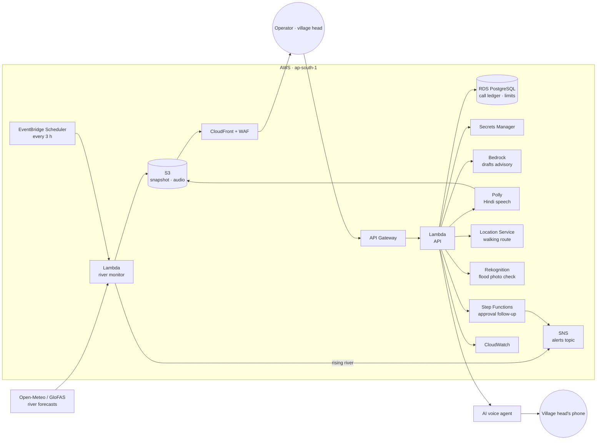
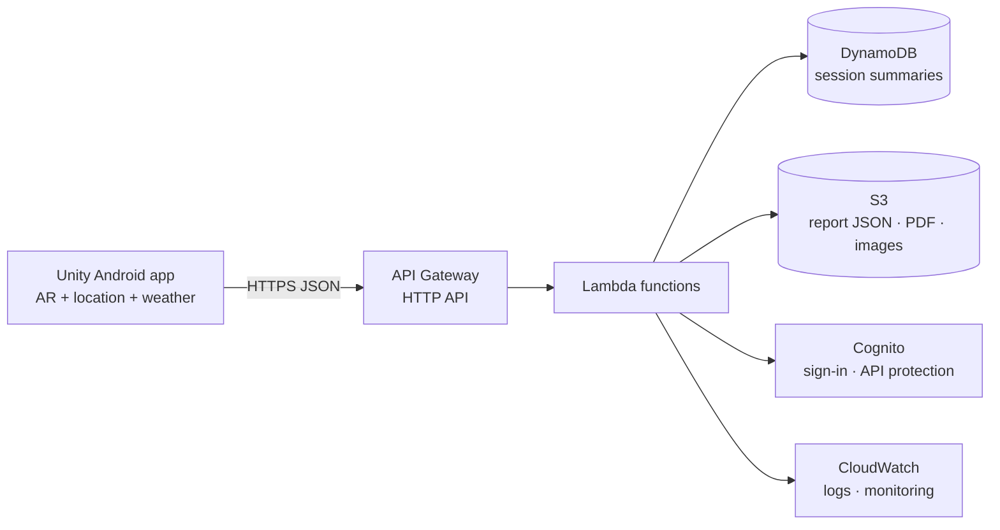

<p align="center"></p>

# JalNetra: Because 2 Hours 43 Minutes Is Too Late

> On 26 August 2026 a glacier collapsed above Langtang in Nepal. The flood raced **226 km** to the Indian border.
> The first alarm on the gauge network came **2 h 43 min** after the collapse. By then the gauges near the source had gone dark, still reading normal.
>
> **JalNetra closes that gap**: it watches every river, finds the villages the water will reach, and lets a person approve a Hindi warning call to the village head. Hours earlier.

**Live demo:** https://d1oi8xa605dsj6.cloudfront.net

---

## What it does

| | |
|---|---|
| **Watch** | 681 river points across India, checked every 3 hours against each river's own record |
| **Predict** | Which of 291 villages along the Gandak the water reaches, and when (now, +3, +6, +12, +24 h) |
| **Decide** | A person reviews the map and the advisory, then approves or rejects. Nothing is automatic |
| **Warn** | One Hindi voice call, a spoken advisory, a 3D evacuation route and an AR arrow to the safe place |

The flow of the site: **Home → Glacier story → Live map → Approve → the phone rings.**

A companion AR app, **Oasis Builder**, works on prevention: see [Part 2](#part-2-oasis-builder-the-prevention-app).

## How it runs on AWS



| Service | Job |
|---|---|
| **Lambda** | River monitor, API, approvals, helpers |
| **EventBridge Scheduler** | Runs the monitor every 3 hours |
| **API Gateway** | Public API, throttled |
| **S3 + CloudFront + WAF** | Website, river snapshot, Hindi audio; rate limits and managed rules |
| **RDS PostgreSQL** | Call ledger, per-alert and daily limits |
| **Secrets Manager** | Keys and the one allowed destination number |
| **Bedrock** (Nova Lite) | Fact-bound Hindi and English advisory drafts, always human-reviewed |
| **Polly** (Kajal) | Spoken Hindi advisory, cached in S3 |
| **Location Service** | Real walking routes to the safe place |
| **Rekognition** | First-screen check of a citizen's flood photo |
| **Step Functions + SNS** | After approval: wait, check, escalate. A call is never retried |
| **SQS** | Alert queue with a dead-letter queue |
| **CloudWatch** | Logs, alarms, the `JalNetra-operations` dashboard |
| **IAM, VPC, CDK** | Least-privilege roles, private networking, infrastructure as code |

Full list, resource names and teardown: [`infra/AWS-SERVICES.md`](infra/AWS-SERVICES.md).

## How good is it? (honest numbers)

Tested against real Sentinel-1 radar flood maps from the 2026 event, leaving each radar date out when training:

- Caught **56% and 66%** of the villages the radar later saw flooded, with false alarms
- Ranking skill (AUC) **0.72 to 0.75** (0.5 is a coin flip)
- An early-warning screen, not a guarantee. **A person always decides**

## Safety by design

- No call is ever automatic. Opening or selecting an alert never calls anyone
- A call can reach **only** the configured demo phone. No route accepts a phone number
- One attempt per alert, a cooldown, 3 calls per session and a daily cap, enforced on the server
- "Dispatched" is never shown as "answered". Failed or unknown outcomes stay locked
- Exercise data is labelled EXERCISE everywhere and kept apart from real incidents

## Part 2: Oasis Builder, the prevention app

JalNetra warns when water is coming. **Oasis Builder** helps a community make less of it arrive.

A Unity Android AR app, built on the same flood data:

1. Point the phone at a plot of land. It reads your location and the local weather (humidity, rainfall)
2. Place a tree or a green patch in AR
3. See what that change does: how much rain water the spot can hold, and how much flood runoff it takes off the river

*Status: prototype. The backend below is the serverless design it is built around.*



| Service | Why it is here | When |
|---|---|---|
| **AWS SAM CLI** | Define, run locally and deploy the backend as code | Use |
| **Lambda** | Small functions that save and read reports | Use |
| **API Gateway** (HTTP API) | HTTPS endpoints the app calls | Use |
| **DynamoDB** | Lightweight session and report data | Use |
| **CloudWatch** | Lambda logs and errors | Automatic with Lambda |
| **S3** | Larger exported files and images | Optional for v1 |
| **Cognito** | User accounts and a protected API | After the anonymous prototype works |
| **EventBridge** | Scheduled cleanup or report processing | Optional |

Deliberately left out for the first version: SageMaker, EKS/ECS/Fargate/EC2 and OpenSearch. A small working serverless backend beats a large pile of disconnected services.

**Build it, then ship it**

- *Build:* AWS SAM CLI and Docker Desktop run Lambda and API Gateway locally, with no cloud cost
- *Ship:* `sam deploy` puts Lambda, API Gateway and DynamoDB on AWS for a public demo URL. Set a billing alert first

## Repo map

| Path | What |
|---|---|
| `src/` | React 19 + TypeScript + Vite site: Home, Glacier story, Live map, Validation, Route and AR |
| `aws-api/` | Lambda API and river monitor, with tests (`npm test`) |
| `infra/` | AWS CDK stack and [`AWS-SERVICES.md`](infra/AWS-SERVICES.md) |
| `pipeline/` | Python scripts that build the flood data from Sentinel and GloFAS |
| `presentation/` | Standalone 3D data-flow scene and the voice-over |

## Run it

```bash
npm install
npm run dev          # http://localhost:5173
npm run build        # single-file dist/index.html
```

API: `cd aws-api && npm install && npm test`. Infrastructure: `cd infra && npm install && npx cdk synth`.

## Data

Sentinel-1 and Sentinel-2 (Microsoft Planetary Computer) · GloFAS river discharge and rain (Open-Meteo) · Copernicus DEM GLO-30 · OpenStreetMap · GeoNames


## Team Members

| Name | GitHub ID | AWS Builder Center Alias |
|---|---|---|
| Swastik Dutt | [GitHub (Swastikkkkk)](https://github.com/Swastikkkkk) | @devswastik |
| Veer Jain | [GitHub (vjn6805)](https://github.com/vjn6805) | @vjn6805 |
| Piyush Agarwal | [GitHub (Piyush5525)](https://github.com/Piyush5525) | @piyush5525 |


---

*JalNetra: जल (water) + नेत्र (eye). The eye on the water.*
